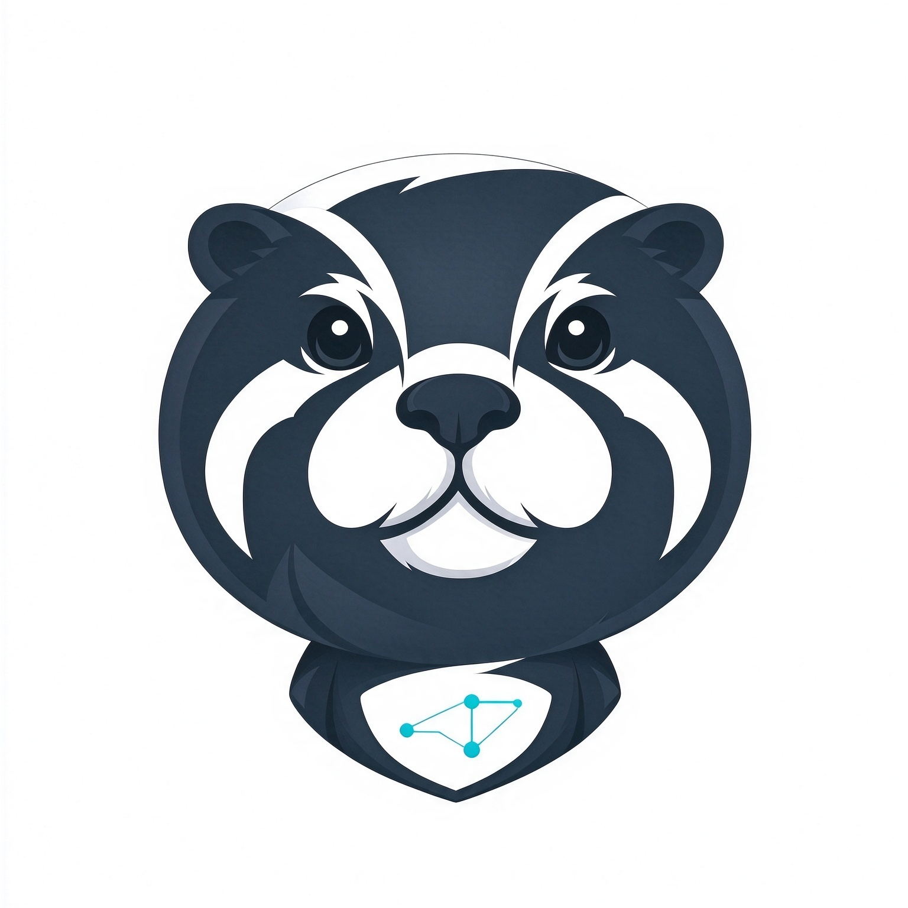

  
  <h1>jelotra</h1>
  
<strong>Keep your toolchain tidy.</strong>

  
Thoughtful, reliable tools for people who build with tools.

## Our story

In fast-moving water, an otter floats on its back, rests a shell on its belly, and uses a stone to open it—patiently, precisely, one tap at a time. The otter may not be the biggest or strongest, but it is curious, focused, and resourceful. It shows how the right tool can make a hard thing manageable.

That idea is at the heart of **jelotra**.

**je** carries the idea of *杰出*—doing excellent work—and the speed of *jet*. **lotra** is inspired by *Lutra*, the Latin name for otters: clever animals known for using tools.

We are developers who use tools every day and build them, too. APIs, integrations, synchronization, components, and all the small pieces around software can become a toolchain of their own. When that chain gets scattered, it takes attention away from the work that matters.

jelotra builds practical, efficient software that brings those workflows together, so developers and technical teams can spend more time building and less time managing the tools around it.

The otter opens a shell with a stone. We use software to crack open the everyday busywork.

**jelotra — tools for people who build with tools.**

## What we build

We start with focused tools for developers and technical teams: software that is clear, dependable, and useful in daily work. Our products span open source and commercial software, united by a simple goal: make complex workflows feel more manageable.

Over time, we hope to bring that same care to tools for a wider range of professionals.

## Our principles

- **Useful:** solve real workflow problems without adding needless complexity.
- **Reliable:** make tools people can depend on in their everyday work.
- **Focused:** leave room for deep work by reducing friction and busywork.
- **Open-minded:** choose open source or commercial models to fit the product and its users.

## Explore

Browse our repositories to discover what we are building. Each project README is the best place to find its current scope, status, and documentation.

---

Built with care by jelotra.

